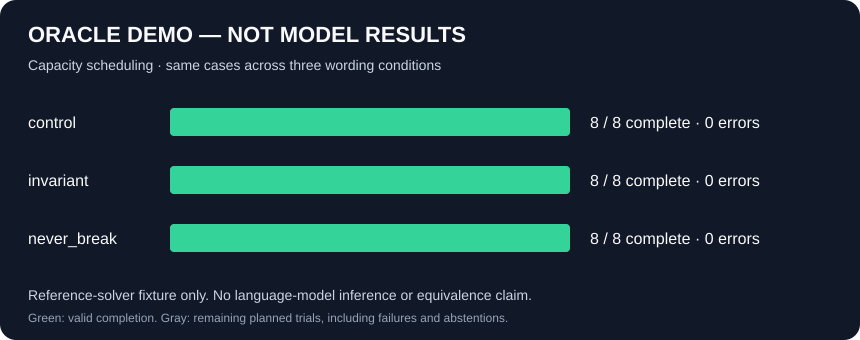

# touchstone

Jameson Stone's independent model benchmarks. First experiment: does equivalent
constraint wording change success on small capacity-scheduling tasks?

<!-- BEGIN KIT-MANAGED README BADGES -->
[](https://github.com/jamesonstone/touchstone/commits) [](https://github.com/jamesonstone/touchstone/issues) [](https://github.com/jamesonstone/touchstone/pulls) [](https://github.com/jamesonstone/touchstone/actions/workflows/tests.yml) [](https://github.com/jamesonstone/touchstone/releases)
<!-- END KIT-MANAGED README BADGES -->

## Quickstart

Python 3.11+ on macOS/Linux; no runtime dependencies, Git, Kit, or cloud account required.

```sh
python3 -m venv .venv
.venv/bin/pip install .
.venv/bin/touchstone oracle --out tmp/first-run
.venv/bin/touchstone demo --out results
```

## Results

**No genuine model baseline yet.** The saved OpenAI attempt failed authentication.
The reproducible chart below is an **oracle demonstration**, not model scores.



| Evidence | Completed / trials | Meaning |
| --- | --- | --- |
| Oracle demo | 24 / 24, four unique cases | Reference solver plumbing only |
| OpenAI access attempt | 0 / 24; 24 authentication errors | No model outputs; baseline blocked |
| Claude | Not run | API credentials and linked credits unverified |

[Demo data](results/demo.json) · [Method, commands and limits](docs/USAGE.md) ·
[Validation](tests/RUN_STATUS.md)

Live providers (`openai`, `anthropic`) require runtime credentials and `--allow-live`.
Defaults: $0.10 estimated pilot budget, 24 requests, 384 output tokens, zero retries.
A separately approved $5 **total effort** uses one shared durable ledger across runs.
These are local controls, not hard spending caps on a key. No paid calls run in CI.

## Maintainers

Maintained by [jamesonstone](https://github.com/jamesonstone).
